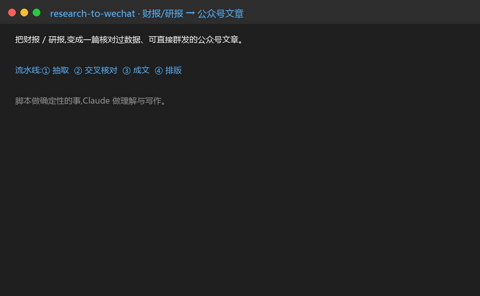

<div align="center">

# research-to-wechat

**把财报 / 研报,变成一篇核对过数据、可直接群发的公众号文章。**

[](https://www.python.org/)
[](LICENSE)
[](https://claude.com/claude-code)

<br>



</div>

> **English**: a Claude Code skill that turns an earnings / research report into a data-verified, publish-ready WeChat Official Account article in one pipeline. See [English](#english) below.

---

## 这是什么

一个 [Claude Code](https://claude.com/claude-code) skill,把「财报 / 研报 → 公众号文章」的完整流程压成一条流水线:

```
财报/研报(PDF / 文本)
      │  extract_pdf.py       抽取 + 关键指标扫描
      ▼
结构化数据(JSON)
      │  validate_figures.py  交叉核对(冲突 / 同比 / 比率 / 资产负债表)
      ▼
核对过的数据
      │  Claude 成文(骨架模板 + 风格指南)
      ▼
文章草稿(Markdown)
      │  render_wechat.py     公众号内联样式 HTML
      ▼
可直接粘贴公众号编辑器的 HTML
```

## 为什么需要它

手动把一份财报写成公众号文章,通常要:从 PDF 翻关键数字(累、易错)、核对口径一致性(单位混用 / 归母 vs 扣非 / 同比算错)、写成文章、再排版。

这个 skill 把**抽取、核对、排版**这三步交给脚本(确定、可靠),把**写作**交给 Claude(理解、判断),并**强制在成文前过一遍数据核对**——避免"数字错了,文章就是事故"。

## 它帮你抓住什么

成文前,脚本自动核对这些财务"雷点",Claude 再在文章里把它们讲透:

| 信号 | 它提醒你 |
| --- | --- |
| 经营现金流 / 净利润 < 0.7 | 赚的是"纸面利润",利润没变成现金 |
| 应收账款增速 > 营收增速 | 可能靠放宽信用冲收入、藏雷 |
| 扣非净利润 ≪ 归母净利润 | 利润靠卖资产 / 补贴,不可持续 |
| 单位混用(万元 / 亿元) | 数字可能差 10000 倍 |
| 毛利率显著高于同行 | 有定价权(护城河) |
| 商誉 / 净资产 > 30% | 减值风险高 |

> 完整规则见 `skills/research-to-wechat/references/style_guide.md`。

## 快速开始

### 安装

**方式一:作为插件安装(推荐)**

```bash
# 把 <owner> 换成你的 GitHub 用户名
/plugin marketplace add <owner>/research-to-wechat
/plugin install research-to-wechat
```

**方式二:手动复制**

```bash
cp -r skills/research-to-wechat ~/.claude/skills/
```

也可以作为项目 skill 使用:放到项目根目录的 `.claude/skills/` 下。

### 使用

在 Claude Code 里直接说:

> 把这份财报 PDF 写成一篇公众号文章: `./财报.pdf`

它会自动走完五步流水线。也可以手动分步调用三个脚本(见下文)。

### 示例

`examples/` 下有可直接跑通的示例(4 份示例财报覆盖白酒 / 新能源 / 银行,均标注为虚构数据)。其中 `golden_article.md` 是一篇**标杆成品文章**(看看产出该是什么水平),`sample_report_tables.pdf` 演示 PDF 表格抽取:

```bash
# 1. 抽取(文本无需依赖;PDF 需 pip install pdfplumber)
python skills/research-to-wechat/scripts/extract_pdf.py examples/sample_report.txt

# 2. 核对
python skills/research-to-wechat/scripts/validate_figures.py examples/sample_figures.json

# 3. 排版
python skills/research-to-wechat/scripts/render_wechat.py examples/sample_article.md --out article.html
```

## 目录结构

```
.
├── README.md
├── LICENSE
├── SUBMISSION.md             # 发布与推广清单
├── assets/
│   └── demo.gif               # 演示 GIF
├── .claude-plugin/
│   ├── plugin.json            # 插件元数据
│   └── marketplace.json       # 单插件 marketplace
├── examples/
│   ├── sample_report.txt             # 通用示例
│   ├── sample_report_consumer.txt    # 白酒
│   ├── sample_report_manufacturing.txt # 新能源
│   ├── sample_report_bank.txt        # 银行
│   ├── sample_report_tables.pdf      # PDF 表格抽取演示
│   ├── golden_article.md             # 标杆成品文章
│   ├── sample_figures.json           # 核对示例输入
│   └── sample_article.md             # 排版示例输入
└── skills/
    └── research-to-wechat/
        ├── SKILL.md               # 核心指令(流水线编排)
        ├── scripts/
        │   ├── extract_pdf.py     # PDF 表格抽取 + 指标扫描 → 结构化 JSON
        │   ├── validate_figures.py# 财务数字交叉核对(8 类检查)
        │   └── render_wechat.py   # Markdown → 公众号 HTML
        ├── templates/
        │   └── article_structure.md
        └── references/
            ├── style_guide.md     # 写作风格 + 财务洞察速查
            ├── validation_rules.md# 核对规则
            └── output_spec.md     # 各环节交接格式
```

## 依赖

- **零依赖可用**:文本 / JSON 输入、数据核对、排版全部用 Python 标准库。
- **PDF 抽取(可选)**:`pip install pdfplumber`(表格友好,推荐)或 `pip install pypdf`。未安装时,`.txt` / `.md` 仍可正常使用。

## 与你的投资 skill 联动(可选)

本 skill 自包含、开箱即用,不依赖其他 skill。若你已装 `financial-data`、`wechat-article` 等 skill,可以:
- 用 `financial-data` 的口径规范补充 `references/validation_rules.md`;
- 用 `wechat-article` 的排版偏好替换 `references/style_guide.md`。

## FAQ

**Q: 它和"直接让 Claude 读 PDF 再写"有什么区别?**

A: 把"抽取、核对、排版"这些确定性步骤固化成脚本,减少幻觉和遗漏;并强制核对数字,而不是凭印象写。

**Q: 图片怎么办?**

A: 公众号不认外链图片,脚本会生成占位符,需手动上传图片后替换。

**Q: 支持扫描件 PDF 吗?**

A: 抽取脚本基于文本层。扫描件需先 OCR(如 PaddleOCR / tesseract)转成文本,再喂给 `extract_pdf.py`。

## License

[MIT](LICENSE)

---

<a id="english"></a>

## English

**research-to-wechat** is a [Claude Code](https://claude.com/claude-code) skill that turns an earnings report or research report (PDF or text) into a publish-ready WeChat Official Account article through a five-stage pipeline: **extract → validate → draft → format → deliver**.

- **extract_pdf.py** pulls text and scans key financial metrics into JSON.
- **validate_figures.py** cross-checks figures (conflicts, growth-rate recomputation, ratio sanity, balance-sheet balance).
- Claude drafts the article using bundled structure/style templates.
- **render_wechat.py** converts the Markdown draft into inline-styled HTML that pastes directly into the WeChat editor.

Zero dependencies for text/JSON input, validation, and rendering; optional `pdfplumber` / `pypdf` for PDF text extraction. MIT licensed.
